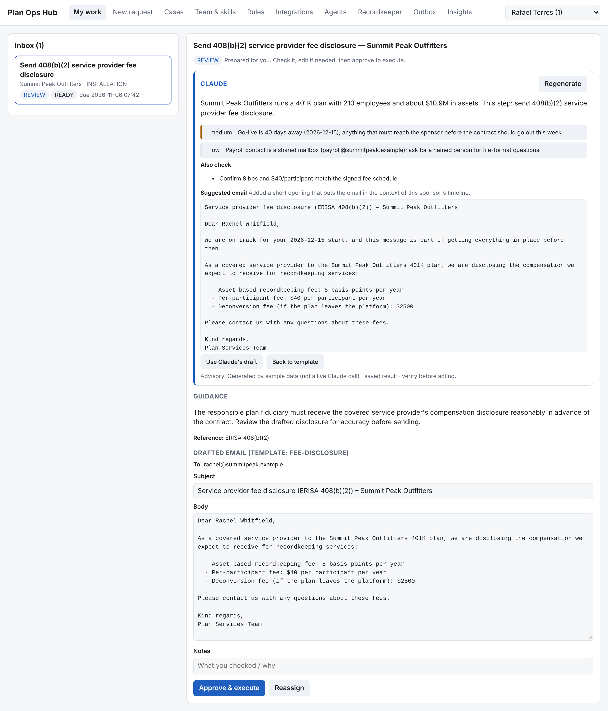
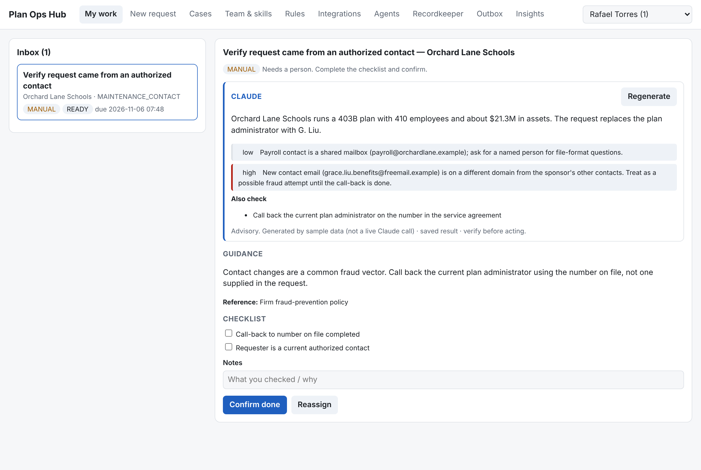
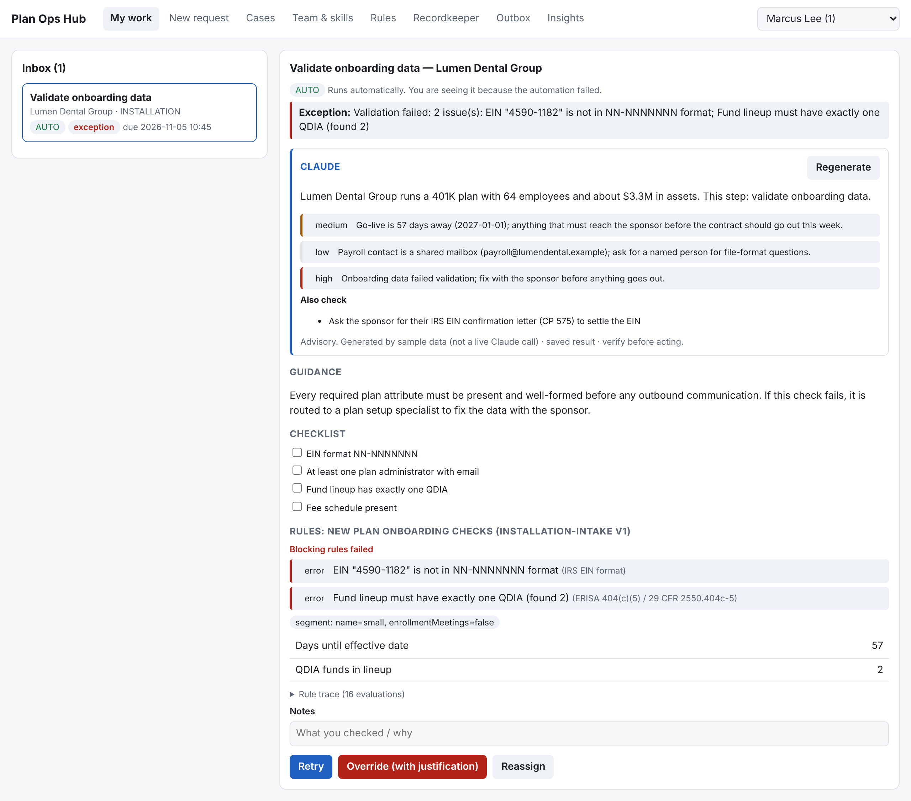
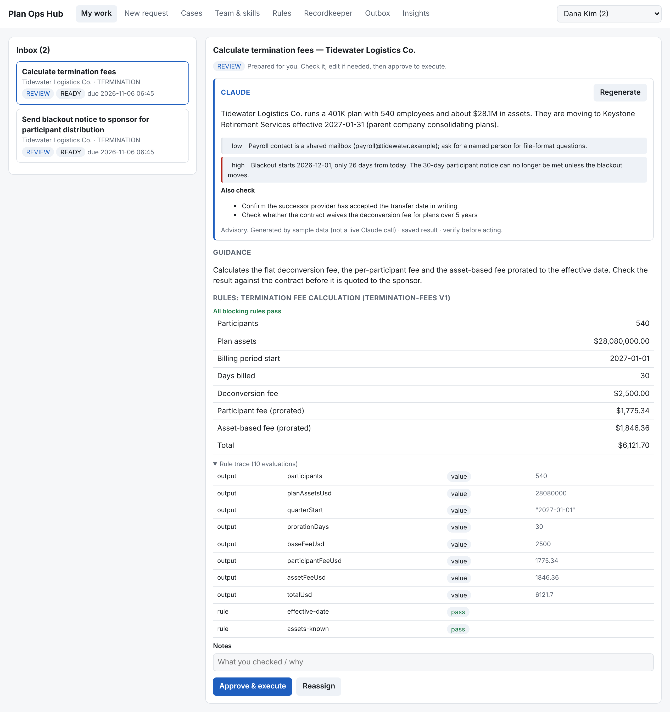
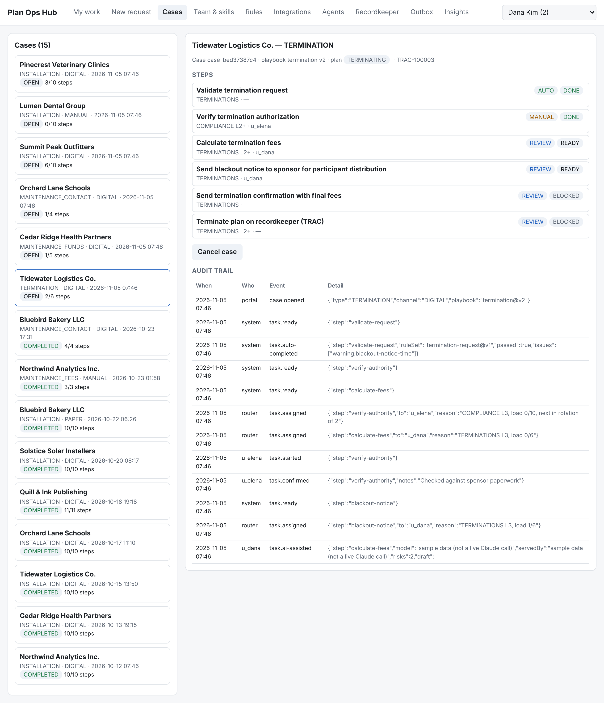
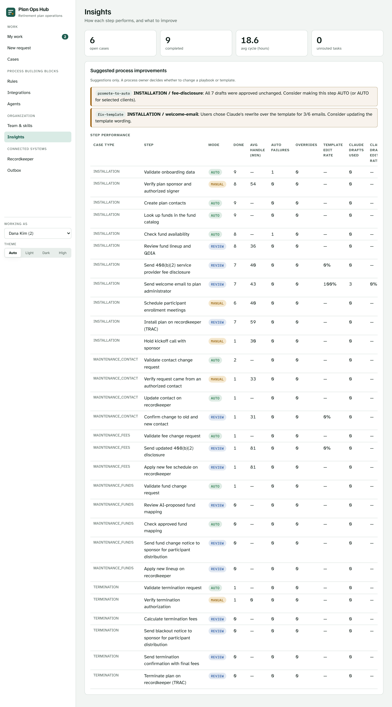
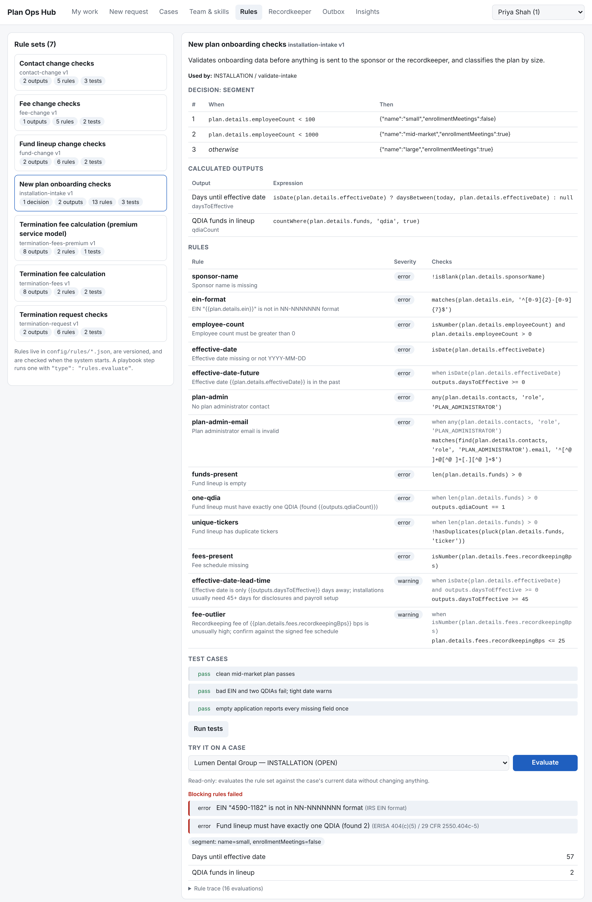
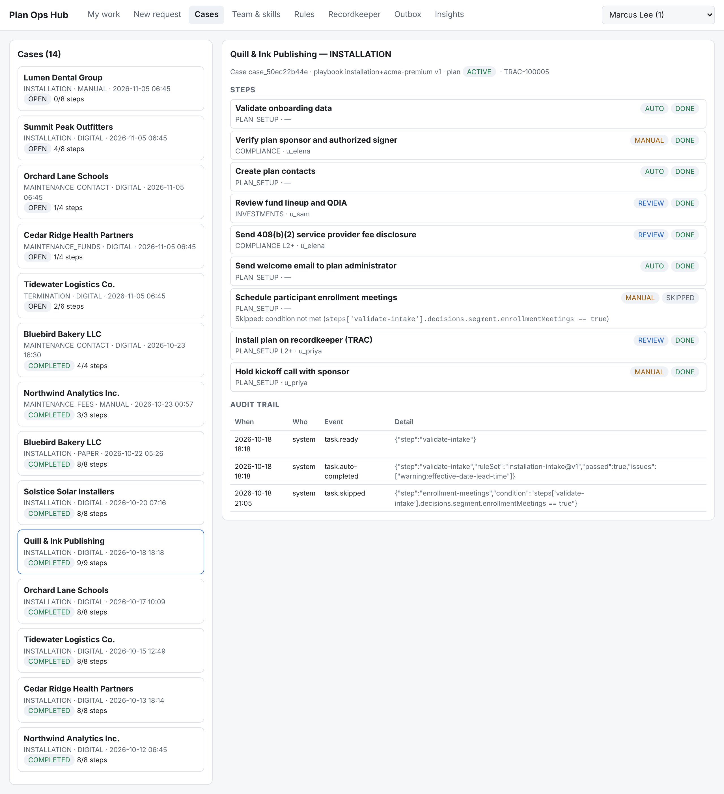

# Plan Ops Hub

A workflow hub for retirement plan operations. It takes a plan from **onboarding
to "Installation Complete"** on the recordkeeper (TRAC), then handles **ongoing
maintenance** (contacts, funds, fees) and **termination / deconversion**.

Requests arrive from any channel (paper, digital, manual). The hub breaks each one
into tasks and **routes them by skill**. For each task it gives **guided actions**
(guidance, checklist, regulatory reference, drafted email or payload, alerts),
automates what is safe, records every action for audit, and **learns** from
outcomes by suggesting process improvements.

Optionally, **Claude** reviews any task on request: a case-specific briefing,
risks it spots in the data, extra checks, and a rewritten email draft. It is
advisory only and can't change which steps run or who receives an email.

Business rules (validations, calculations, decision tables) are configuration,
not code: versioned rule sets in `config/rules/` that run as steps in any
process, can make later steps conditional, and carry their own test cases. See
[docs/RULES.md](docs/RULES.md).

See [docs/ARCHITECTURE.md](docs/ARCHITECTURE.md) for the design.

## Screenshots

From `npm run demo` (fictional sponsors; the Claude panels show labeled sample responses because no API key was set).

| | |
|---|---|
|  **My work:** a 408(b)(2) disclosure with guidance, Claude's briefing and rewritten draft |  **Contact change:** Claude flags a new admin email on a free-mail domain |
|  **Exception:** bad EIN and two QDIAs routed to a person to fix, retry or override |  **Termination:** fee calculation for review, with a blackout-notice timing risk |
|  **Cases:** step status, assignees and the audit trail |  **Insights:** step metrics and suggested process changes |
|  **Rules:** a rule set's decision table, formulas and checks; tests run; evaluated against a live case |  **Conditional step:** enrollment meetings skipped because the rules classified the plan as small |

More: [paper intake](docs/screenshots/06-new-request-paper.png), [team & skills](docs/screenshots/07-team-skills.png), [recordkeeper](docs/screenshots/08-recordkeeper.png), [outbox](docs/screenshots/09-outbox.png), [phone](docs/screenshots/11-mobile-task.png).

## Run

Requires Node.js 22.18+. Node runs the TypeScript directly and uses its built-in SQLite.

```bash
npm install
npm start            # http://localhost:3000  (PORT, DB_PATH env vars optional)
npm test             # end-to-end tests (no network; AI calls are faked)
npm run typecheck
```

### Enabling Claude

Set `ANTHROPIC_API_KEY` (or `ANTHROPIC_AUTH_TOKEN` / `ANTHROPIC_PROFILE`) before
`npm start`. Without credentials the app runs normally and the Claude panel is
hidden; `AI_ASSIST=off` disables it even when credentials are present.

```bash
ANTHROPIC_API_KEY=sk-ant-... npm start
```

Each "Ask Claude" makes one call to `claude-opus-5-5`. Results are stored per
task and reused until the task's data changes, and every call is recorded in the
audit trail with its token usage. Plan and contact data from the case is sent to
the Anthropic API, so check that this fits your data-handling policy before
turning it on.

### Demo with sample data

```bash
npm run demo         # http://localhost:3000
```

Loads 14 cases for fictional sponsors into an in-memory database: completed
installations (digital and paper), fee and contact changes, a termination in
progress, a suspicious contact change, a fund change, and an installation stuck
on bad data. Every specialist has work waiting; switch users with the picker.
Without an API key the Claude panel shows canned responses marked as sample
data; with `ANTHROPIC_API_KEY` set, **Regenerate** calls Claude. Nothing is
written to disk.

### Try it

1. **New request** → submit the sample installation (or switch the channel to *Paper* to see OCR-text intake).
2. **Cases** → the auto steps are already done, and human steps are assigned by skill.
3. Use the user picker (top right) to switch to Elena (Compliance), Sam (Investments) or Priya (Plan Setup). In **My work**, open each task, complete the checklist, review or edit the draft, then *Approve & execute*.
4. When the last step runs, the plan appears in **Recordkeeper** and the case shows *Installation Complete* in its audit trail.
5. Submit a maintenance request or a termination against the active plan.
6. With Claude enabled, open a task and click **Ask Claude**, then **Use Claude's draft** to load its email into the editor. **Insights** compares how often Claude's drafts and the templates get edited.
7. Things to try: submit an installation with a bad EIN (the exception goes to a person), click *Simulate outage* before the TRAC step (then retry), deactivate Sam in **Team & skills** (fund reviews queue up), or import a SCIM user (the queue drains).

## Layout

```
config/
  playbooks/   one versioned JSON process definition per request type
  templates/   email templates ({{plan.details.sponsorName}} …)
  clients/     per-client overrides (disable/add steps, change modes, swap templates and rule sets)
  rules/       versioned business rule sets with embedded test cases
  users.json   seed users and skills
src/
  intake/      channel normalization + validation rule sets
  cases/       case & work-item engine
  users/       user directory, SCIM import
  routing/     skill router
  knowledge/   playbooks, templates, client overrides
  guidance/    guided actions
  actions/     action executor (prepare / execute)
  integrations/ TRAC adapter (mock), email gateway
  learning/    insights & improvement suggestions
  ai/          Claude assistance (prompt, structured output, caching, guardrails)
  rules/       rule engine: expression language, rule sets, tests
  api/         HTTP API
public/        single-page UI (no build step)
scripts/       demo data and demo server
test/          end-to-end tests
```

## API (summary)

| Method | Path | |
|---|---|---|
| POST | `/api/intake` | `{caseType, channel, clientId?, planId?, data? , documentText?}` |
| GET | `/api/inbox/:userId` | open work items for a user |
| GET | `/api/tasks/:id/guidance` | guided action for a task |
| POST | `/api/tasks/:id/complete` | `{edits?, notes?, override?, draftSource?}` (header `x-user-id`) |
| GET | `/api/rules`, `/api/rules/:id` | rule sets |
| POST | `/api/rules/:id/test`, `/api/rules/:id/evaluate` | run a rule set's tests; evaluate against `{caseId}` or `{context}` |
| GET | `/api/ai/status` | whether Claude is enabled |
| GET / POST | `/api/tasks/:id/ai-assist` | stored result / ask Claude (`{refresh?}`) |
| POST | `/api/tasks/:id/reassign` | `{toUserId?}` |
| GET | `/api/cases`, `/api/cases/:id` | cases with tasks and audit trail |
| PATCH | `/api/plans/:id` | correct onboarding data (before installation only) |
| POST | `/api/users/import/scim` | sync users and skills from the IdP |
| GET | `/api/trac/plans`, `/api/outbox`, `/api/insights`, `/api/audit` | |

> Regulatory references and the fee model are illustrative and need review by compliance before real use.
